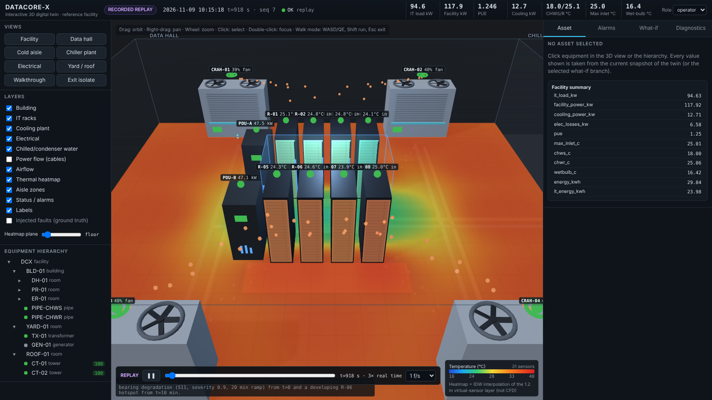
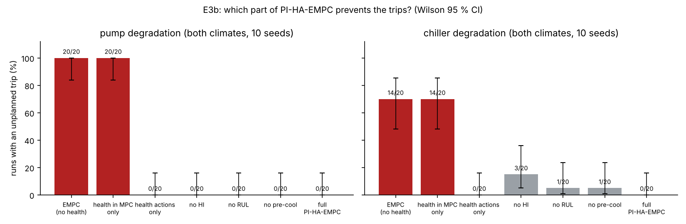
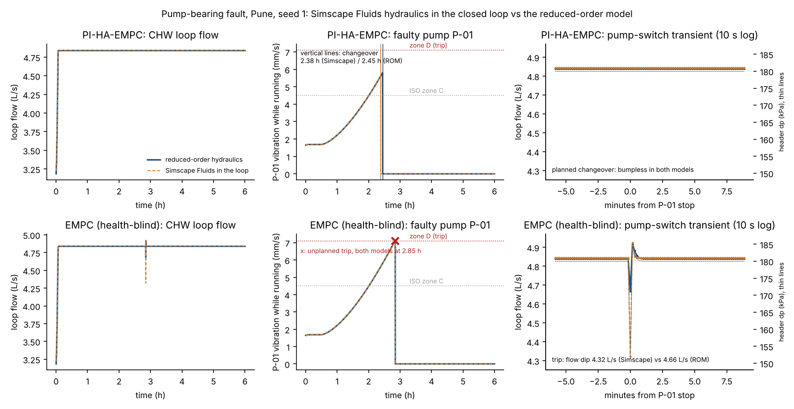
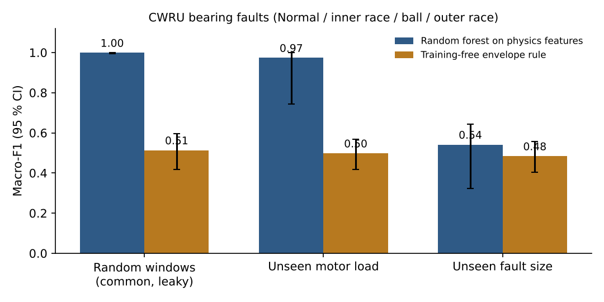
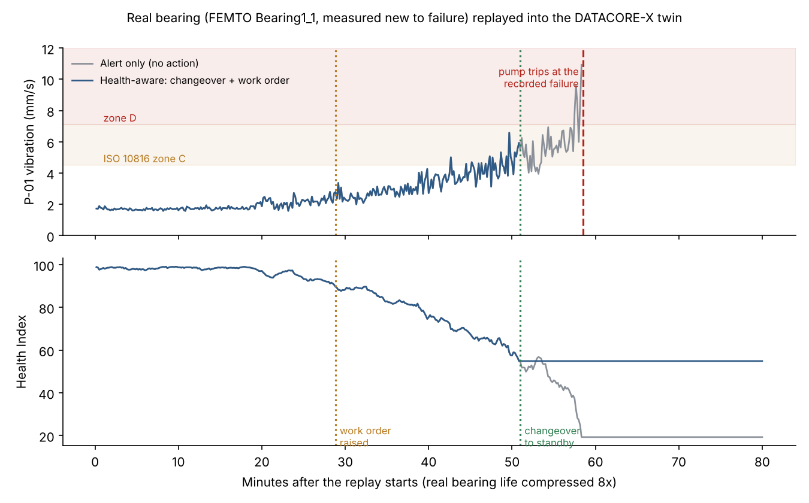
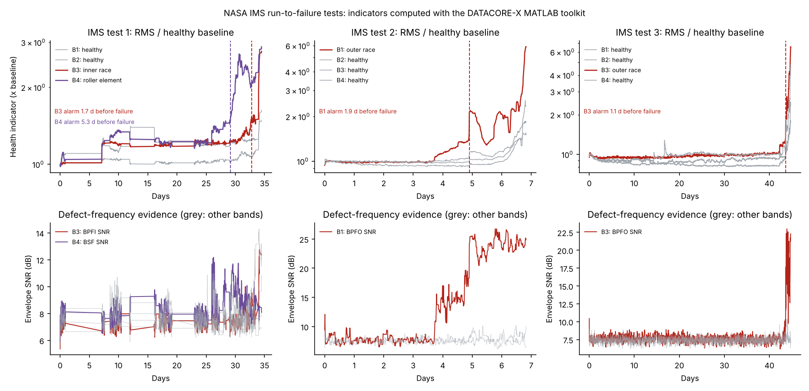
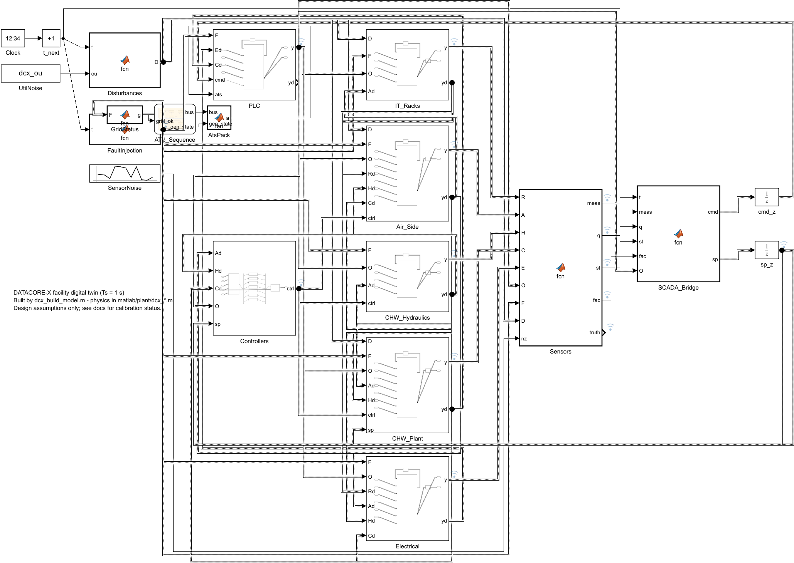

# DATACORE-X

**A digital twin of a data-centre cooling plant with predictive maintenance and health-aware control, from vibration analysis to work orders in SCADA.**

MATLAB / Simulink / Simscape Fluids · Python (FastAPI, OPC UA) · Ignition 8.3 Perspective · Three.js



DATACORE-X simulates an 8-rack, roughly 100 kW air-cooled data hall. It models the IT load, CRAH units, a chilled-water loop with three pumps, two chillers, cooling towers, a water-side economiser and a 2N UPS path. On top of the plant it does four things:

1. **Monitoring:** it estimates the health of the cooling equipment (Health Index and remaining useful life) online, from measured signals.
2. **Control:** a supervisory economic MPC, **PI-HA-EMPC**, uses that health information. It changes over to a standby pump or chiller before a predicted failure, instead of waiting for a trip.
3. **Maintenance:** it raises maintenance work orders on its own, with priority, due date, actions and parts. Operators acknowledge, schedule and close them in Ignition SCADA.
4. **Validation on real data:** the vibration-analysis and remaining-life methods are tested on three public bearing datasets (CWRU, FEMTO/PRONOSTIA, NASA IMS). Real bearing failures can also be replayed into the twin.

This is a final-year B.Tech project (Instrumentation and Control Engineering, Vishwakarma Institute of Technology, Pune). The control results are written up as a journal manuscript in [`paper/`](paper/main.pdf).

> **Scope:** the plant is a calibrated, cross-verified **simulation** of a hypothetical facility. The real-data results use bearing vibration from public test rigs, not from a cooling plant. Nothing here claims field performance.

---

## Key results

| What | Result |
|---|---|
| Cooling energy vs fixed setpoints (PI baseline) | −20.4 % in Pune, −15.7 % in Frankfurt (10 seeds, measured 2025 weather) |
| Unplanned equipment trips under pump/chiller degradation | EMPC 34/40 → **PI-HA-EMPC 0/40**, with no extra energy |
| Which part of the controller prevents the trips (component ablation, 86 runs) | The health-triggered changeover / lead transfer: **0/40** alone. Health used only inside the MPC: 34/40, no better than EMPC |
| Simscape Fluids hydraulics in the closed loop | Same outcomes as the reduced-order model; flow within 0.1 %, energy within 0.01 % |
| MPC solve time | 25 ms mean per 60 s step |
| Model verification | Simulink and MATLAB stepper match an independent Python implementation on 42/42 checks; 712/713 scenario and physics checks pass |
| CWRU fault diagnosis, leak-free splits | Macro-F1 0.999 (random windows) → 0.973 (unseen load) → **0.541 (unseen fault size)** |
| FEMTO remaining-life prediction, official IEEE PHM 2012 score | 0.209 vs 0.126 for a naive baseline; alarm before failure on 16 of 17 bearings |
| NASA IMS run-to-failure (3 tests, 12 bearings) | All 4 failed bearings flagged 26–128 h ahead; no false RMS alarms on the 8 healthy bearings; fault type correct for 3 of 4 |
| Real FEMTO bearings replayed into the twin | Work order 3–4 h and pump changeover 1.0–1.6 h before the recorded failure, no trip |

---

## What's in the repository

```
matlab/                MATLAB / Simulink / Simscape Fluids (R2024a)
  model/               DCX_Facility.slx: Simulink facility model (+ Stateflow ATS sequence)
  plant/               reference MATLAB stepper, used for the 586-run study
  simscape/            Simscape Fluids chilled-water network and its validation
  control/             PI-HA-EMPC supervisor, MPC design and identification, experiments E1–E6,
                       Simscape closed-loop co-simulation (DcxSscCosim, dcx_ssc_loop)
  pdm/                 fault classifiers, isolation forests, RUL models (E5)
  vibration/           vibration toolkit: bearing frequencies, envelope / spectral kurtosis, ISO 10816
  params/  config/  tests/  bridge/  docs/
app/datacore-x/        operational twin (Python + web)
  backend/             FastAPI REST/WebSocket, OPC UA server, surrogate plant, alarms, historian,
                       work orders, real-bearing replay, scenario engine; pytest suite
  frontend/            Three.js 3D twin (data hall, racks, CRAHs, plant)
  ignition/            Ignition 8.3 setup: OPC UA connection, tags, ISA-18.2 alarms, Perspective screens
  tests_e2e/           Playwright end-to-end tests, scenario/physics cross-verification
  dist/                stand-alone 3D demo (open datacorex_3d_twin_demo.html in a browser)
pdm_realdata/          vibration analysis and RUL on CWRU, FEMTO and NASA IMS (scripts, results, figures)
paper/                 manuscript (LaTeX + PDF), tables and figures
START_DATACORE-X.bat   one-click start (backend + OPC UA + Ignition client)
REPRODUCE.md           how to regenerate every number in the paper
```

---

## How it works

```
 MATLAB / Simulink / Simscape plant ──┐
 (or the Python surrogate)            │ 217 sensor points
                                      ▼
                Health estimation: physics residuals → Health Index, RUL
                                      │
              PI-HA-EMPC (60 s): EMPC setpoints + health-triggered actions
                                      │
          ┌───────────────────────────┼─────────────────────────────┐
          ▼                           ▼                             ▼
   FastAPI + OPC UA            Work-order manager              3D twin (Three.js)
          │                    (priority, due date
          ▼                     from the RUL lower bound)
   Ignition Perspective: overview, equipment, ISA-18.2 alarms, scenarios, maintenance, compare
```

### Controllers compared

| Controller | What it does |
|---|---|
| Fixed setpoints + PI | Conventional thermostatic baseline |
| EMPC | Economic MPC (MPC Toolbox) minimising facility power, subject to rack-inlet ≤ 27 °C; health-blind |
| PI-HA-EMPC | EMPC + health-scaled move bounds, RUL-triggered pre-cooling, and prognostic actions (pump changeover, standby-chiller pre-start, lead transfer) |

---

## Quick start

### 1. Operational twin + Ignition (Windows)

Requirements: Python 3.11+ (Node 18+ only to rebuild the frontend). Ignition 8.3 is optional, for the SCADA screens.

```bat
python -m venv app\venv
app\venv\Scripts\pip install -r app\datacore-x\requirements.txt
START_DATACORE-X.bat
```

The twin then runs at http://localhost:8000 and the Perspective client at http://localhost:8088/data/perspective/client/DATACORE_X. Ignition setup, including where to put the gateway API key (never commit it), is described in [`app/datacore-x/README.md`](app/datacore-x/README.md).

You can try the 3D twin without installing anything: open [`app/datacore-x/dist/datacorex_3d_twin_demo.html`](app/datacore-x/dist/datacorex_3d_twin_demo.html).

**Demo of a real bearing failure:** on the Maintenance tab set the speed to 60x. On the Scenarios tab run **S17 Real bearing replay**, then **Apply to live plant**. Watch the alarm, the work order and the pump changeover.

### 2. MATLAB study

Requirements: MATLAB R2024a with Simulink, Stateflow, Simscape, Simscape Fluids, MPC, System Identification, Statistics and ML, and Predictive Maintenance toolboxes.

```matlab
cd matlab
dcx_startup
run_all                                  % full study, about 5 h serial; see REPRODUCE.md for the stages
dcx_study('Plan',"ablation2",'Workers',0)   % E3b component ablation (86 runs)
R = dcx_ssc_loop();                      % Simscape Fluids hydraulics in the closed loop (pump fault)
```

### 3. Real-data benchmarks

The datasets are not in this repository; [`pdm_realdata/README.md`](pdm_realdata/README.md) says where to download them.

```bash
pip install numpy scipy pandas scikit-learn matplotlib statsmodels
python pdm_realdata/python/cwru_bench.py
python pdm_realdata/python/femto_rul.py
python pdm_realdata/python/ims_analysis.py
```

NASA IMS indicators are extracted in MATLAB with `matlab/vibration/ims_extract.m`.

---

## Selected figures

| | |
|---|---|
|  |  |
| Which part of the controller prevents the trips | Simscape Fluids hydraulics in the closed loop |
|  |  |
| CWRU accuracy under leak-free splits | A real FEMTO bearing replayed into the twin |
|  |  |
| NASA IMS run-to-failure indicators | Simulink facility model |

---

## Honest limitations

- The plant and all control results are **simulated**, and degradation is time-compressed into hours.
- The Simscape closed-loop check covers the chilled-water hydraulics in one scenario; the thermal plant is reduced-order.
- In the tested scenarios, the trip protection comes from the health-triggered supervisory actions. Health terms inside the MPC gave no additional protection (ablation E3b).
- Remaining-life prediction on real data is weak. On FEMTO it beats the naive baseline but is far from exact. On IMS the model beats a naive guess on only 2 of 4 failures.
- The classifier does not generalise to an unseen fault size (CWRU 0.541), and the envelope analysis misreads ball/roller faults.

## Citation

See [`CITATION.cff`](CITATION.cff). The Zenodo DOI will be added after the first tagged release.

## License

BSD 3-Clause, see [`LICENSE`](LICENSE). The public datasets (CWRU, FEMTO/PRONOSTIA, NASA IMS) keep their own terms and are not redistributed here.
