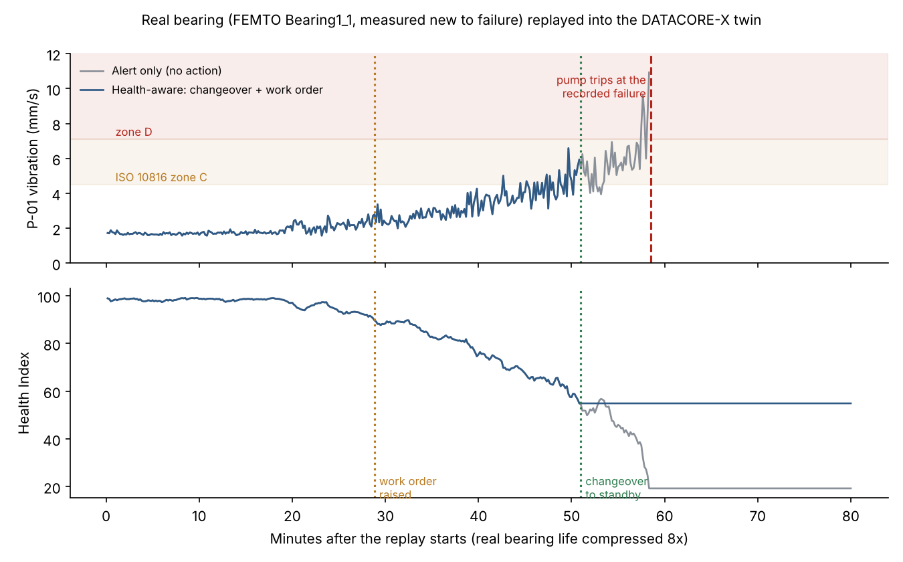
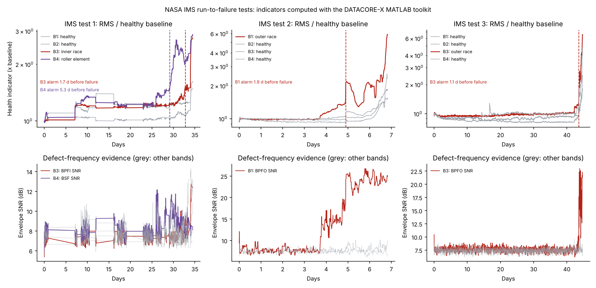

# DATACORE-X v2: validation on real bearing data, and alarm-to-action

DATACORE-X began as a simulation-only project. This folder adds three things:

1. a **vibration analysis toolkit**: time-domain indicators, ISO 10816 velocity, FFT, envelope spectrum, bearing defect frequencies and spectral kurtosis. It exists in MATLAB (`matlab/vibration/`) and in Python (`python/dcx_vib.py`), and the two are cross-checked against each other;
2. a **benchmark on public run-to-failure and fault data**: FEMTO/PRONOSTIA (IEEE PHM 2012), CWRU and NASA IMS;
3. **real data inside the live twin**: a measured bearing failure is replayed into pump P-01 and then drives the twin's health estimation, an automatic changeover, Ignition alarms and an auto-generated maintenance work order.

All numbers below come from the scripts in this folder. Nothing was tuned on test data. The one place where a rule was revised after seeing a result is stated where it happens.

## 1. Vibration toolkit (Phase A)

| Indicator | Meaning |
|---|---|
| RMS, peak, crest factor, kurtosis, skewness | time-domain severity and impulsiveness |
| `vrms_mms` | RMS velocity 10-1000 Hz (mm/s), the ISO 10816 / 20816 quantity used by the twin's alarms |
| band energies | spectral energy below 1 kHz, 1-5 kHz and above 5 kHz |
| envelope SNR at BPFO / BPFI / 2xBSF / FTF | dB of the defect line (3 harmonics, ±3 % slip) above the local envelope floor; the band is chosen by spectral kurtosis |

**Defect frequencies** come from the bearing geometry: `vib_bearing_freqs`. The CWRU 6205 multipliers reproduce the published 3.585 / 5.415 / 2.357 / 0.398 x shaft speed.

**Diagnostic plots** (`vib_plot_diagnostics.m`) show the waveform, the spectrum, and the envelope spectrum with defect markers. On CWRU recordings, the MATLAB toolkit gives:

| Recording | BPFO SNR | BPFI SNR | 2xBSF SNR | Highest |
|---|---|---|---|---|
| 105 inner race | 18.5 dB | **30.5 dB** | 13.2 dB | BPFI, correct |
| 130 outer race | **30.2 dB** | 19.2 dB | 23.9 dB | BPFO, correct |
| 118 ball | 17.3 dB | 10.5 dB | 11.9 dB | not resolved, see section 2 |

**MATLAB vs Python cross-check** (CWRU 105, same 24,000 samples):
- Time-domain and velocity indicators agree to 4 decimals.
- With the same envelope band, the envelope SNRs agree within 0.6 dB.
- The two spectral-kurtosis implementations pick different bands, which is a known difference between them.

## 2. Fault diagnosis on CWRU, with leak-free splits (Phase B)

**Data and setup**
- 64 recordings: all 12 kHz drive-end faults (inner race, ball, outer race; 0.007-0.028 in; outer race at 3, 6 and 12 o'clock) and the 4 normal baselines.
- The normal baselines were recorded at 48 kHz. They are decimated to 12 kHz first; otherwise a model can identify "normal" from the sampling rate alone.
- 4,096-sample windows (1,842 in total).
- Macro-F1, with 95 % cluster-bootstrap intervals over recordings.
- The GitHub mirror used here was checked byte for byte against the official CWRU files (MD5 match on 3 of 3).

| Split | Random forest on physics features | Training-free envelope rule |
|---|---|---|
| Random windows (the usual, leaky protocol) | 0.999 [0.994, 1.000] | 0.513 [0.418, 0.595] |
| Leave one motor load out | 0.973 [0.744, 1.000] | 0.498 [0.419, 0.567] |
| Leave one fault size out | **0.541** [0.324, 0.643] | 0.484 [0.405, 0.557] |

**What this shows.** The 99-100 % accuracy that is common in CWRU papers is real, but only when windows from the same recording sit on both sides of the split. The classifier generalises across motor load. It does **not** generalise to a fault size it has never seen: macro-F1 falls to 0.54, mostly from confusion between ball and outer-race faults. The training-free envelope rule is weaker overall, but it needs no fault data at all.

## 3. RUL on FEMTO / PRONOSTIA, official IEEE PHM 2012 protocol (Phase B)

**Protocol**
- Train on the 6 learning bearings and predict the 11 test bearings at the official cut-off.
- Score with the official asymmetric function: 1 is exact, and late predictions are penalised more than early ones.
- The official true RULs match the data files for 10 of 11 bearings. For Bearing1_4 the sheet says 339 s while the files give 2,890 s; the official value is used.

**Health Index.** RMS vibration over the bearing's own first 10 minutes, smoothed causally. The failure level is learned from the training bearings.

| RUL method | Official score | Mean abs. error |
|---|---|---|
| Naive: mean training life minus elapsed time | 0.126 | 380 % |
| DATACORE-X linear HI trend (the twin's method) | 0.160 | 242 % |
| HI + exponential degradation, Bayesian prior, bounded | **0.209** | 117 % |

**Revision note.** The first run of the exponential model was unbounded and produced estimates of up to 2 million seconds. Bounds learned only from the training bearings were then added, and the result was scored once.

**Early warning.** The alarm fired before failure on 16 of 17 bearings, with a median lead of 11 minutes (12 % of life). On three bearings (2_1, 2_2, 2_3) it fired on an early transient, 60-86 % of life before failure. FEMTO is known for sudden end-of-life failures, and the challenge organisers note that classical defect-frequency signatures do not apply to it.

## 4. Real data in the live twin (Phase C)

**What scenario S17 does.** It replays the measured vibration velocity of a FEMTO bearing, from new to failure, onto pump P-01's vibration sensor. Only the bearing's *measured increase* over its own healthy level is added to the pump's modelled vibration. Both are RMS velocity in the ISO band, so the alarm limits keep their meaning. The bearing ages only while the pump runs. If it reaches its recorded failure while running, the pump trips.

**The twin's response** (8x time compression; times converted back to real bearing time):

| Bearing | Work order raised | Health-aware changeover | Alert only: pump trips at |
|---|---|---|---|
| FEMTO Bearing1_1 | 3.8 h | 6.8 h (1.0 h before failure, 87 % of life used) | 7.8 h |
| FEMTO Bearing1_3 | 3.6 h | 5.0 h (1.6 h before failure, 75 % of life used) | 6.6 h |

**Independence.** The twin's estimator (`dcx-physics-residual-v0`) was written for the simulated plant and was never tuned on FEMTO data.

**Caveat.** The source test rig is not a chilled-water pump. This is real bearing degradation applied to the pump's sensor, not a recorded pump failure.



## 5. From alarm to action: maintenance work orders (Phase D)

The twin raises work orders automatically from Health Index and RUL, with priorities:
- **P3 Planned:** HI below 65.
- **P2 High:** HI below 45, or RUL below 2 h.
- **P1 Urgent:** HI below 25, or RUL below 30 min.

Each order carries:
- the asset and its criticality (redundancy check);
- the likely fault and its evidence (residuals, vibration with ISO zone, replayed-data source);
- RUL with its bounds, and a due date (the lower RUL bound minus a 20 % margin);
- recommended actions, parts, trade and labour hours;
- control actions the system already took, and a full status history.

**Lifecycle:** OPEN → ACKNOWLEDGED → SCHEDULED → CLOSED. Closing records maintenance complete on the plant and returns the asset to service.

**Where it shows:** the Ignition **Maintenance** tab. Orders export as CMMS-style JSON (fields map to Maximo, SAP PM and UpKeep) and as a printable page (save as PDF). The API is `GET /api/workorders`, `POST /api/workorders/{id}/ack|schedule|close`, `GET /api/workorders/{id}/print` and `/cmms.json`.

**Health-aware changeover policy.** The same rule as the MATLAB PI-HA-EMPC supervisor: change over when HI < 25 or RUL < 15 min. It acts on bearing faults only, because a changeover does not cure cavitation (a system NPSH problem). It can be switched on and off from Ignition or `POST /api/policy`.

## 6. Verification

- **Backend tests:** 28/28 pass (24 existing + 4 new: replay to failure, changeover avoiding the trip, work-order lifecycle, no work orders on a healthy plant).
- **Scenario cross-verification:** 712/713 checks, including all 43 new S17 checks. The remaining failure is an existing heat-balance check at its tolerance edge (0.31 vs 0.30 kW). The unmodified code fails it the same way when run from the same live state.

## 7. NASA IMS run-to-failure (3 tests, 12 bearings)

The indicators were computed on the laptop with the MATLAB toolkit (`matlab/vibration/ims_extract.m`; ZA-2115 geometry, 2000 rpm, fs = 20.48 kHz, 9,464 snapshots × 4 bearings) and analysed with `python/ims_analysis.py`. Ground truth: test 1 B3 inner race and B4 roller; test 2 B1 outer race; test 3 B3 outer race. All the bearings sit on one shaft, so when a healthy bearing alarms after its neighbour has failed, the alarm is counted as *propagated*, not as a false alarm.

| Test / bearing | Fault | RMS alarm lead | Envelope alarm lead | Dominant defect band | Correct? |
|---|---|---|---|---|---|
| 1 / B3 | inner race | 40.8 h | – | BPFI (+1.7 dB) | yes |
| 1 / B4 | roller | 127.5 h | 10.7 h | BPFO (+3.4 dB) | no |
| 2 / B1 | outer race | 46.0 h | 69.0 h | BPFO (+15.9 dB) | yes |
| 3 / B3 | outer race | 26.0 h | 24.8 h | BPFO (+5.2 dB) | yes |

- **Detection:** 4 of 4 failed bearings alarm before failure on RMS, and 3 of 4 on the envelope rule.
- **False alarms:** of the 8 healthy bearings, none raised a false RMS alarm; 7 alarmed only after a neighbour had failed. The envelope rule gave 1 genuine false alarm (test 3 B4, 38 h before the end).
- **Diagnosis:** correct for 3 of 4. The roller-element fault is misread as outer race, a known difficulty because ball spin frequencies are weak in the envelope.
- **RUL after the alarm** (leave one bearing out, exponential model vs a naive "same lead as the others" guess): MAE 90.7 vs 25.7 h, 35.6 vs 65.5 h, 53.3 vs 18.8 h, 8.3 vs 45.4 h. The model wins on 2 of 4. With four failures this is not evidence that it beats the naive guess; it is reported as is.



## Reproduce

Datasets are not in the repository. Put them under `data/` at the repository root (or point the `DCX_DATA` environment variable elsewhere):

| Dataset | Where to get it | Place it in |
|---|---|---|
| CWRU bearing data (12k drive end + normal baseline) | Case Western Reserve University Bearing Data Center (engineering.case.edu/bearingdatacenter) | `data/raw/cwru/` |
| FEMTO / PRONOSTIA (IEEE PHM 2012 challenge) | FEMTO-ST Institute; public mirrors exist on GitHub | `data/raw/femto/` (`Learning_set/`, `Full_Test_Set/`) |
| NASA IMS bearings | NASA Prognostics Center of Excellence data repository ("Bearings") | `data/raw/ims/`, then run `matlab/vibration/ims_extract.m`, which writes `data/ims_features_t*.csv` |

The extracted features for CWRU and FEMTO are already in `results/` (`*_features.csv.gz`), so the benchmark and RUL steps run without the raw data:

```
python python/cwru_bench.py         # CWRU splits (re-extracts only if results/cwru_features.csv.gz is missing)
python python/femto_extract.py      # FEMTO indicators (needs the raw data)
python python/femto_rul.py          # IEEE PHM 2012 protocol, official score
python python/ims_analysis.py       # IMS (needs data/ims_features_t*.csv)
python python/ims_fig.py
python python/make_figs.py          # figures (the FEMTO waterfall needs the raw data)
```

Results go to `results/` and figures to `figures/`. Re-running the scripts on the released features reproduces `cwru_results.json`, `femto_summary.json`, `femto_rul_results.csv` and `ims_results.json` byte for byte.

**Data sources**
- FEMTO-ST / PRONOSTIA: Nectoux et al., IEEE ICPHM 2012.
- CWRU Bearing Data Center (official .mat files; mirror verified by MD5).
- IMS: J. Lee et al., NASA Prognostics Data Repository.
